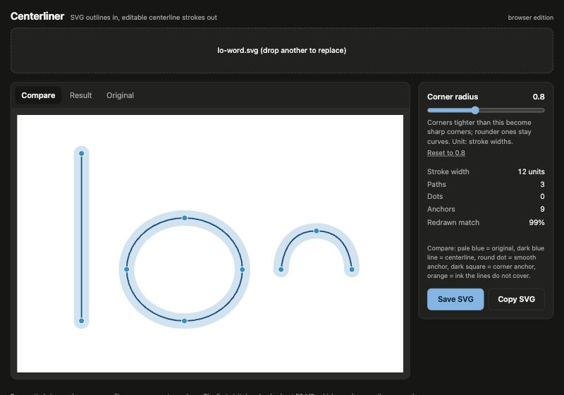

# Centerliner

Turns filled vector outlines of roughly even width (icons, monoline lettering) into editable **centerline strokes**: one open path down the middle of each stroke, with round caps, so you can restyle the line afterwards (weight, caps, dashes).

**Try it in the browser: https://kemie.github.io/centerliner/** — drop an SVG, check the Compare view, save the result. Everything runs in your browser; your file is never uploaded. (The first visit downloads about 50 MB; later visits are faster.)



## What it takes, and what it gives back
- **In:** an SVG with one colour and filled outlined shapes of roughly even width. SVG only (no PNG/JPG, PDF/EPS/AI or DXF; export SVG from your drawing app first).
- **Out:** an SVG of stroked paths (round caps), with straight lines, arcs, circles and ovals kept exact where the outline allows it, and smooth Bézier curves elsewhere.
- **Compare view** shows the original (pale blue), the result (dark blue line), smooth anchors (round dots), corner anchors (squares) and any ink the lines don't cover (orange).
- **Corner radius** slider: bends tighter than this (in stroke widths, default 0.8) become sharp corners; gentler ones stay curves.

## Known limits
- Works best on clean, single-colour, even-width outlines. Round caps are assumed (flat-capped ends come out half a stroke width short).
- Places where three strokes meet within about one stroke width can differ from what you would draw.
- Some icons with very irregular shapes (an apple-type outline, for instance) can come out slightly differently depending on where they sit on the pixel grid.
- Tilted or open ovals are not well tested.
- Tested on about 20 icons and 12 generated shapes, in Chrome only. Not yet tested in Safari, Firefox or on phones.

## Run it on your computer instead
Needs Python 3. Same engine, faster start, no 50 MB download.
```
python3 -m venv .venv
.venv/bin/pip install -r requirements.txt
./Centerliner.command          # opens http://127.0.0.1:8765/ in your browser (macOS: double-click works too)
./centerline input.svg output.svg --corner-radius 0.8     # command line
```
(`./Centerliner.command` and `./centerline` are small shell scripts; on Windows run `.venv\Scripts\python app\server.py` instead.)

## How it works (short version)
Renders the outline at about 20 px stroke width, finds the sub-pixel medial axis (centre of the shape), prunes it into a graph, fits Bézier curves, then reads straight lines, arcs, circles and ovals directly from the SVG geometry where it can and snaps to them.
Engine: `prototypes/centerline_exact.py` (plus `exact_*.py`). Desktop app: `app/`. Browser edition: `docs/` (a copy of the engine compiled to run in the browser via Pyodide; refresh it with `docs/sync-engine.sh`).

## Tests
`testset/` holds 12 generated shapes (with their true centerlines). To check that engine changes haven't shifted anything:
```
cd prototypes
CENTERLINE_ENGINE=centerline_exact ../.venv/bin/python regression.py            # lists what changed against results/baseline-centerline_exact.txt
```

## Licence
[MIT](LICENSE). Third-party libraries (numpy, scipy, scikit-image, Pillow, Shapely, svgpathtools, resvg, Pyodide) keep their own licences.
